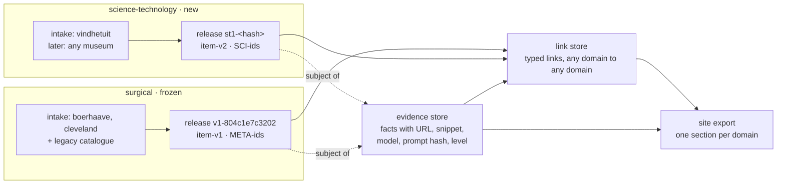

# ADR 001: one release line per domain

Status: **accepted** by the lead, 2026-11-14. Task T-003. Phase 1 of `VINDHETUIT_PLAN.md`.

## Decision in one picture



Each domain has its own intake allowlist, ID registry and release line. Nothing a museum did
not publish is written into a record. Enrichment and links are separate layers that point at
record IDs, so they can be rerun without changing any release hash.

## What we found (observations, 2026-11-14)

| Observation | Where | Consequence |
|---|---|---|
| The release builder reads **every** `data/intake/*/records.jsonl` | `scripts/web/dataset.py:155` | Any new intake folder joins the surgical release on the next build |
| The frozen release used 2 intake sources (boerhaave, cleveland; 0 records added) | `results/tables/dataset_coverage.json` | — |
| 11 more intake folders are on disk, untracked, with 35,913 included records | `results/tables/museum_harvest_2026-10-28.md` | **A build today would mint about 36,000 permanent IDs** and replace the 2,830-record release |
| The site build calls the release builder | `scripts/web/build_site.py:31` | Building the website has the same effect |
| The ID registry is append-only and one copy is stored in each release | `data/registry/identifiers.json` (next id 2831, 8,103 aliases) | Minting IDs for a second domain in the same registry changes a file inside every later surgical rebuild |
| `item-v1` forbids extra fields (`additionalProperties: false`) | `data/schema/item-v1.schema.json` | A `domain` field cannot be added without changing all 2,830 records |

No build was run in this session. T-001 already forbids DeepSeek from running one.

## Options

| | Option | Surgical release | Verdict |
|---|---|---|---|
| A | Add `domain` to every record, one mixed release | changes (new hash, new version) | rejected: breaks the acceptance rule |
| B | One mixed release, domain inferred from the source | records unchanged but release grows to about 4,000 records, new version | rejected: published results cite `v1-804c1e7c3202` |
| **C** | **A release line per domain, with shared evidence and link layers** | **byte-identical; rebuild reproduces it** | **chosen** |

## Decision

1. **Domains are declared, not discovered.** `configs/domains.yaml` lists each domain with its
   intake sources, schema, registry and ID prefix. The builder reads only the sources listed for
   the domain it is building. An intake folder not listed anywhere is reported and ignored.

   ```yaml
   surgical:
     sources: [boerhaave, cleveland]
     schema: data/schema/item-v1.schema.json
     registry: data/registry/identifiers.json
     id_prefix: META
     release_prefix: v1
     frozen: v1-804c1e7c3202        # a build that produces anything else fails
   science-technology:
     sources: [vindhetuit]
     schema: data/schema/item-v2.schema.json
     registry: data/registry/science-technology.json
     id_prefix: SCI
     release_prefix: st1
   ```

   A new museum is one more line under `sources`. The 2026-10-28 harvest stays out until the lead
   decides which domain release it joins and when.

2. **IDs.** `SCI-000001…`, permanent, append-only, in their own registry. Aliases:
   `vindhetuit:<slug>` and `accession:<institution>:<inventory id>`. Institution names are
   normalised once (`Rijksmuseum Boerhaave` → `Museum Boerhaave`), in the same table the surgical
   builder uses.

3. **Schema `item-v2`.** `item-v1` plus `domain` and `source.aggregator` (the site a record was
   read from, e.g. vindhetuit.nl). The surgical-only parts (`functions`, working annotation)
   become optional. The source's own "related objects" list is kept under `raw` and exported as
   a baseline link set; it is the site's claim, not ours.

4. **Evidence store** (`data/evidence/<domain>/facts.jsonl`, schema `evidence-v1`). One row per
   enriched fact: subject ID, field, value, URL, quoted snippet, model, prompt hash, date, type,
   level (documented / inferred / AI hypothesis), and the image crop for readings. Machine
   descriptions live here too. Records are never edited by enrichment.

5. **Link store** (`data/links/links.jsonl`, schema `link-v1`). One row per typed link: from,
   to, type, channels, confidence, level, evidence row IDs. IDs from any domain are allowed, so a
   science object can link to a surgical one.

6. **The same object in two domains.** Boerhaave objects in Vind het uit that are already in the
   surgical release (matched on institution and inventory number) are **not merged**. They get a
   `same_object` link, level documented, and each domain keeps its own record. Phase 0 measures
   how many there are (T-001 lists the Boerhaave inventory ids).

7. **Site export.** One export per domain under `data/<release>/`, plus a small `domains.json`
   pointer. The surgical export code path is unchanged; its section moves in the navigation only.

## How "byte-identical" is tested

| Check | Passes when |
|---|---|
| `data/releases/FROZEN.json` (new, committed) lists the SHA-256 of every file in `v1-804c1e7c3202` | a unit test rehashes the directory and matches |
| Rebuild of the surgical domain with the allowlist in place | version is `v1-804c1e7c3202`; `records.jsonl`, `assets.json`, `identifiers.json` and `manifest.json` are byte-equal to the frozen copies |
| `git diff --exit-code -- data/releases/v1-804c1e7c3202 data/registry/identifiers.json` after building both domains | exit code 0 |
| A decoy intake folder with one included record | the surgical build ignores it and reports it as unlisted |

These run in the `tests` stage and before any deploy.

## Order of work

1. **Guard first** (small, before any other build): allowlist in the builder, `FROZEN.json`, the
   four checks above.
2. `item-v2`, the `SCI` registry and the science-technology build, validated on the T-001 intake.
3. Evidence and link schemas with validators and an evidence export for curators.
4. Boerhaave `same_object` links and the overlap table.

## Consequences

- Two schemas to maintain until the surgical release is next rebuilt on purpose.
- Cross-domain analyses read two release files; a small loader hides this.
- The pipeline config gains a domain per stage; existing surgical stages keep their keys, so
  nothing downstream reruns.
- Open for the lead: whether the 35,913 harvested surgical records join a future surgical
  release `v2`, and whether Boerhaave objects shown in both sections should display once.
